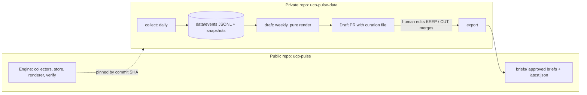

# UCP Pulse

Weekly, evidence-backed intelligence on the Universal Commerce Protocol (UCP): spec releases, release
amendments, SDK and registry versions, governance changes, and declared breaking changes. Every statement in a
published brief traces to a stored evidence record with a source URL, an exact ref, and a time.

UCP Pulse is an independent experiment. It is not affiliated with or endorsed by the UCP project, its governing
bodies, or any company that participates in it. It is research and analysis, not legal or compliance advice.

Status: experimental, v0.1. 311 offline tests pass. The engine has been run end to end locally; no scheduled
deployment is live yet. See [Status and known limits](#status-and-known-limits).

## Why this exists

UCP is an open standard for agentic commerce. Its spec is date-versioned and moves quickly: four dated releases
between January and August 2026, with backports landing on released lines, breaking changes announced in PR
titles and discussions, two SDKs, a schema tool, and several governance bodies. A builder who ships against it
needs to know three things each week: what changed, what is breaking, and how sure we are.

Most feeds answer "what happened" with a summary. UCP Pulse answers with a ledger. It separates what a source
declares from what a human confirmed, labels what it could not check, and refuses to turn a merged pull request
into "available" without evidence.

## What it tracks

| Source | What is collected | Status |
| --- | --- | --- |
| S1 Spec releases | tags, GitHub releases and `release/*` branch heads, modeled as one release line per dated version | enabled |
| S2 Spec PRs | merged PRs on any base branch, plus open PRs declared breaking (`!` in the title or the merge subject, or a breaking label) | enabled |
| S3 Normative commits | commits touching `source/**`, `docs/specification/**` and the versioning policy; changed JSON pointers; `ucp_request` / `ucp_response` location; local `$ref` dependents | enabled |
| S4 Announcements | dated entries in the spec repo's announcements file | enabled |
| S5 Governance | governance, maintainers, election and charter files in the org `.github` repo | enabled |
| S6 SDKs and tooling | tags, releases and breaking PRs for the JS SDK, Python SDK and `ucp-schema` | enabled |
| S7 PyPI | `ucp-sdk` versions, bound to the official repository | enabled |
| S8 npm | `@ucp-js/sdk` versions | enabled |
| S9 Discussions | breaking-change notices posted in the spec repo's Discussions | disabled (needs an authenticated read with enough rate budget; shown as a coverage gap) |
| S10 Shopify changelog | UCP-scoped entries only, behind a strict entity gate | enabled |

Out of scope by design in v1: live probing of any merchant, catalog or checkout endpoint; LLM-written prose;
community sources; scoring; automatic compatibility verdicts.

## How it works



Two decoupled schedules, as in [mpp-pulse](https://github.com/schwentker/mpp-pulse), the project this one is
modeled on:

1. **Collect (daily).** Reads sources, appends new evidence revisions, updates cursors and source health, commits
   atomically. No report logic, no language model.
2. **Draft (weekly).** Renders a brief for every due period from the persisted store only. The renderer is a pure
   function: no network, no clock. It opens a pull request containing the brief and a curation file.

A human reads the draft, marks each evidence item `KEEP` or `CUT`, writes any headline, signal or watch-next text
with required citations, and merges. Merge is the approval. Only then does the export job copy the brief to this
public repository.

### Why two repositories

Anything pushed to a public repo is already public. Evidence, unapproved drafts and curation live in a private
repo. This repo holds the engine, tests, fixtures, deployment templates, and approved briefs only. The private
repo checks out the engine at a pinned commit.

### Evidence model

- `event_id` is the upstream identity (for example `ucp:pr:431`, `ucp:release:2026-04-08`,
  `pypi:ucp-sdk:0.5.0`). It never changes when titles or notes are edited.
- `revision_id` is a content hash of the fields that matter for that kind of event. Edits, backports and
  re-published packages become new revisions of the same event, linked by `supersedes`.
- Each record carries `event_time` and its kind (merged, tagged, published, posted, observed) separately from
  `first_seen_at`.
- Facts are independent values, not a status ladder: opened, notice posted, merged, tagged, release published,
  package published, amended, yanked, deleted. The renderer shows facts and never derives "shipped".
- Snapshots (bounded fragments, hashes, exact refs) make claims reproducible without copying whole upstream
  documents. Spec versions and SDK versions never share a field.

### Time model

All times are UTC. Periods are half-open weeks starting Sunday (`p-2026-11-01` covers
`[Nov 1 00:00Z, Nov 8 00:00Z)`). A brief includes everything first seen in its period. Items whose event time is
earlier are listed as late arrivals with their original time. A due-period ledger means a dropped or delayed
scheduled run is caught up by the next run. Cursors resume from the last complete page with overlap, and a failed
or partial source never advances its cursor.

### Declared and reviewed breaking changes

UCP's versioning policy asks breaking PRs to include `!` in the title and to be announced in Discussions ahead
of merge. UCP Pulse records three kinds of signal separately:

- **author-declared:** `!` in the PR title or the merge commit subject, or a breaking label;
- **notice-declared:** an official announcement or discussion naming a breaking change;
- **analyst-confirmed:** set by a human in the curation file.

Schema changes under normative paths are listed with changed JSON pointers, whether they sit under request or
response annotations, and which other schema files reference them. Their classification stays `unknown` until a
human sets it. The tool does not claim to find every breaking change. It reports declared and reviewed ones, with
coverage notes.

### Brief layout

Fixed order, mandatory blocks never cut: headline, signal, watch next; version board (spec release lines, JS SDK,
Python SDK, `ucp-schema`, PyPI, npm); breaking and pending-breaking; release amendments; normative changes for
review; official notices; governance; Shopify changelog (UCP-scoped); late arrivals; coverage; generated source
ledger. A pending or cut item can never appear in an approved brief.

## Safety properties

- **Read-only.** Collectors issue GET requests and read-only GraphQL to an allowlist of hosts. No call is made to
  any merchant, catalog, cart or checkout endpoint.
- **Bounded HTTP.** HTTPS only, timeouts, byte caps, no off-host redirects, no credential forwarding across
  hosts, ETag caching, pagination guards. Below 100 remaining GitHub rate budget (or missing rate headers), all
  further GitHub reads stop.
- **Fail closed.** One failing source never aborts others and never advances its own cursor. Unknown schema
  semantics stay `unknown`. Ambiguous identities and unrecognized files are rejected.
- **Verified rendering.** `verify` fails if the committed brief differs from a fresh render, if any cited item is
  not `KEEP`, or if derived state differs from a rebuild from the event log.
- **Least privilege automation.** Workflows start from `permissions: {}`, actions are pinned by commit SHA,
  upstream text is never interpolated into shell commands, and the export token exists only as a secret in the
  private repo.
- **Offline tests.** The test harness blocks network access, including child processes; Git behavior is tested
  against local bare repositories.

## Repository layout

```text
src/ucp_pulse/        collectors, HTTP client, store, periods, diff, renderer, verify, automation, export
config/sources.yaml   per-source enablement and gate notes
templates/data-repo/  workflows, PR template and config for the private data repo
tests/                offline tests and fixtures (real and labeled synthetic)
docs/DECISIONS.md     implementation decisions and the reason for each
docs/RUNBOOK.md       setup, approval flow, recovery and engine updates
docs/build/           phase reports and build summary
docs/BUILD-PLAN.md    the normative design this implementation follows
docs/planning/        earlier plan, review notes and build prompts (history)
LICENSE               MIT
```

## Quick start

Requires Python 3.12 (pinned `>=3.12,<3.13`) and Git.

```sh
git clone https://github.com/schwentker/ucp-pulse.git
cd ucp-pulse
python3.12 -m venv .venv
.venv/bin/python -m pip install -r requirements-dev.txt
export PYTHONPATH="$PWD/src"
PYTEST_DISABLE_PLUGIN_AUTOLOAD=1 .venv/bin/python -m pytest -q    # expect: 311 passed
.venv/bin/python -m ucp_pulse --help
```

To run the full pipeline you need your own private data repository created from `templates/data-repo/`, a
fine-grained token for the export step, and the settings described in [docs/RUNBOOK.md](docs/RUNBOOK.md). Live
collection reads public sources; set `GITHUB_TOKEN` in your environment for a usable GitHub rate budget. The
token is never printed or stored in evidence.

## Status and known limits

As of 2026-11-07:

- The pipeline has been exercised locally: a backfill from 2026-01-11 produced 864 verified revisions (4 spec
  release lines, 391 spec PRs, 195 normative commits, 10 announcements, 6 governance files, 193 SDK PRs, 30 SDK
  tags, 10 PyPI and 12 npm versions, 9 Shopify changelog entries). All of it is pending human review; nothing
  from that run has been published.
- S9 (Discussions) is disabled. The brief says so in its coverage block.
- The PyPI package is bound to the official repository through the exact source link in its description plus the
  pinned manifest in that repository, because PyPI's project URLs are empty. Normative commits for the backfill
  were recovered from a pinned clone of the official public repository after REST connection failures; scheduled
  runs use the REST collector.
- Release amendments are classified by the paths each cited change touches: `spec` (touches `source/**`,
  `docs/specification/**` or the versioning policy), `docs only`, or `unknown`. A line is never labeled
  spec-amended without a cited spec-path item. Tag position ("tag at branch head") is recorded as observed; the
  tool does not infer that a tag moved. An amendment is not proof that a release artifact was republished.
- Every brief table shows event time with its kind (merged, tagged, published, posted) next to first-seen time. Schema detail lines are compact text; raw JSON stays in `brief.json`.
- No semantic schema compatibility verdicts. Unknown stays unknown.
- Actions-minute budgeting has not been measured; see the runbook before enabling schedules.

## Design lineage

The two-schedule, evidence-first design follows [mpp-pulse](https://github.com/schwentker/mpp-pulse): collect on
one schedule, report from a persisted window on another, deterministic source ledger appended by code, and a
model that never discovers facts. UCP Pulse replaces its cloud stack with Git as the store and audit log, and a
pull request as the approval gate.

## License

MIT. See [LICENSE](LICENSE).

## Contributing

Issues and pull requests are welcome, especially fixtures: a real upstream case that the collectors misclassify,
with its source URL and retrieval date. Please keep tests offline and do not include tokens, cookies or personal
data in fixtures.
